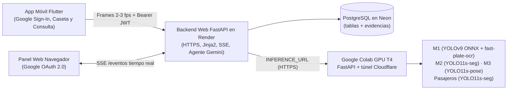

# Sistema Inteligente de Control de Peaje

Sistema de control de peaje de punta a punta basado en visión por computadora, desarrollado para el Laboratorio Final de Hito (**entrega: 25/11/26**). Integra detección de placas + OCR (**M1**), segmentación de instancias de vehículos (**M2**), keypoints de ruedas/ejes (**M3**), conteo de pasajeros por segmentación (**extra +5**), gestión de entornos reproducibles (**extra +5**), aplicación móvil en Flutter, backend web en tiempo real (SSE) con Google OAuth 2.0 y agente conversacional con Gemini.

## Integrante (entrega individual)

| Integrante | Usuario GitHub | Roles |
|---|---|---|
| Adiel | `@Adiel05` | Datasets en Roboflow, entrenamiento en Colab, servidor de inferencia, backend web + API + SSE + agente, aplicación móvil Flutter y documentación |

## Arquitectura



## Tecnologías usadas

- **Web, API y tiempo real:** Python 3.12, FastAPI, SQLAlchemy 2, PostgreSQL (`psycopg` v3), Jinja2, Server-Sent Events (SSE), Authlib (Google OAuth 2.0), PyJWT.
- **Agente conversacional:** Gemini (`google-genai`, `gemini-2.5-flash`) con function calling sobre herramientas conectadas a PostgreSQL y respaldo determinista por reglas.
- **Modelos de IA e inferencia:**
  - **M1:** `yolo-v9-t-384-license-plates-end2end.onnx` + `fast-plate-ocr` (`cct_xs_v2_global.onnx`) en `onnxruntime`.
  - **M2:** `yolo11s-seg` (5 clases: `moto`, `auto`, `minibus`, `camion`, `bus`).
  - **M3:** `yolo11s-pose` (`kpt_shape: [1, 3]`, 1 keypoint en el centro de cada rueda para estimar ejes).
  - **Pasajeros (+5):** `yolo11s-seg` (clase `person`) con máscaras opacas para privacidad (sin reconocimiento facial ni recortes de rostros).
- **App móvil:** Flutter (Android), `camera`, `google_sign_in`, `http`, `image_picker`, `shared_preferences`.
- **Infraestructura en la nube:** Render (web), Neon (PostgreSQL), Google Colab T4 + Cloudflare Tunnel (entrenamiento e inferencia), GitHub Actions / Flutter CLI (APK).

## Estructura del repositorio

```text
├── entrenamiento/       # Notebooks de Colab (M2, M3, validación M1 y métricas pasajeros) + requirements.txt
├── inferencia/          # Servidor único FastAPI (/health, /infer), módulo M1, pesos ONNX M1 y notebook Colab
├── web/                 # Aplicación web, API v1, SSE, agente, plantillas Jinja2 y pruebas pytest
├── movil/               # Aplicación móvil Flutter (Android)
├── scripts/             # Script de diagnóstico de entornos (diagnostico.py)
├── docs/                # Guías, plantilla de informe y OpenAPI exportado (docs/openapi.json)
├── .env.example         # Plantilla de variables de entorno (sin secretos)
└── render.yaml          # Blueprint de despliegue para Render
```

## API REST v1 y documentación Swagger

La documentación interactiva OpenAPI/Swagger está disponible en `/docs` (y exportada en [`docs/openapi.json`](docs/openapi.json)). Todas las rutas `/api/v1/*`, excepto `/api/v1/auth/google`, requieren `Authorization: Bearer <jwt>` o sesión web autenticada.

| Método | Ruta | Descripción |
|---|---|---|
| `POST` | `/api/v1/auth/google` | Valida el `id_token` de Google Sign-In, verifica lista blanca y emite JWT |
| `GET` | `/api/v1/auth/me` | Perfil del usuario autenticado |
| `GET` | `/api/v1/casetas` | Lista de casetas de peaje |
| `POST` | `/api/v1/pasos/frame` | Recibe frame desde caseta móvil, llama a inferencia, registra paso, emite SSE y alerta |
| `POST` | `/api/v1/placas/consultar` | Consulta estado de una placa por texto |
| `POST` | `/api/v1/placas/consultar-imagen` | Lee placa desde imagen (M1) y consulta su estado |
| `GET` | `/api/v1/placas/{placa}/historial` | Historial de pasos de una placa |
| `GET` | `/api/v1/casetas/{id}/resumen` | Conteo y recaudación del día por caseta |
| `POST` | `/api/v1/agente/chat` | Agente conversacional (texto y/o imagen) |
| `GET` | `/api/v1/panel/resumen` | Resumen global de hoy |
| `GET` | `/api/v1/estado/inferencia` | Ping `/health` al endpoint de inferencia |
| `GET` | `/api/v1/diagnostico` | Diagnóstico del entorno web (solo admin) |

## Entornos reproducibles (+5) y diagnóstico

Cada servicio define sus dependencias fijadas:

1. **Web (`/web/requirements.txt`)**:
   ```bash
   cd web
   python -m venv .venv
   # Windows: .venv\Scripts\activate  |  Linux/macOS: source .venv/bin/activate
   pip install -r requirements.txt
   python ../scripts/diagnostico.py
   ```
2. **Inferencia (`/inferencia/requirements.txt`)** en Colab:
   ```bash
   pip install -r inferencia/requirements.txt
   python scripts/diagnostico.py > /content/drive/MyDrive/peaje/evidencias/diagnostico_inferencia.txt
   ```
3. **Entrenamiento (`/entrenamiento/requirements.txt`)** en Colab:
   ```bash
   pip install -r entrenamiento/requirements.txt
   python scripts/diagnostico.py > /content/drive/MyDrive/peaje/evidencias/diagnostico_entrenamiento.txt
   ```
4. **Móvil (`/movil/pubspec.yaml` y `/movil/pubspec.lock`)**:
   ```bash
   cd movil
   flutter pub get
   ```

## Despliegue

1. **Base de datos (Neon):** Crear base PostgreSQL gratuita y copiar `DATABASE_URL`.
2. **Web (Render):** Conectar el repo con `render.yaml` (`rootDir: web`), configurar las variables de `.env.example` (sin subir `.env` al repo) y verificar `https://<tu-app>.onrender.com/docs`.
3. **Inferencia (Google Colab):** Abrir `inferencia/servidor_colab.ipynb` con GPU T4, ejecutar todas las celdas y copiar la URL `https://*.trycloudflare.com` en la pantalla **Estado** (`/estado`) de la web.
4. **App móvil (Flutter):**
   ```bash
   cd movil
   flutter build apk --release \
     --dart-define=API_BASE_URL=https://<tu-app>.onrender.com \
     --dart-define=GOOGLE_WEB_CLIENT_ID=<TU_CLIENT_ID_WEB>.apps.googleusercontent.com
   ```

## Enlaces del proyecto (completar antes de la entrega)

- **Guía paso a paso de configuración y despliegue:** [`docs/guia_usuario_pasos.md`](docs/guia_usuario_pasos.md)
- **Aplicación web (HTTPS):** `https://<pendiente-render>.onrender.com`
- **Endpoint de inferencia (Colab):** Configurable dinámicamente en `/estado` (`INFERENCE_URL`)
- **Dataset M2 (Roboflow):** `<pendiente-url-roboflow-m2>`
- **Dataset M3 (Roboflow):** `<pendiente-url-roboflow-m3>`
- **Dataset Pasajeros (Roboflow):** `<pendiente-url-roboflow-pasajeros>`
- **Carpeta de evidencias (Drive):** `<pendiente-url-drive>`
